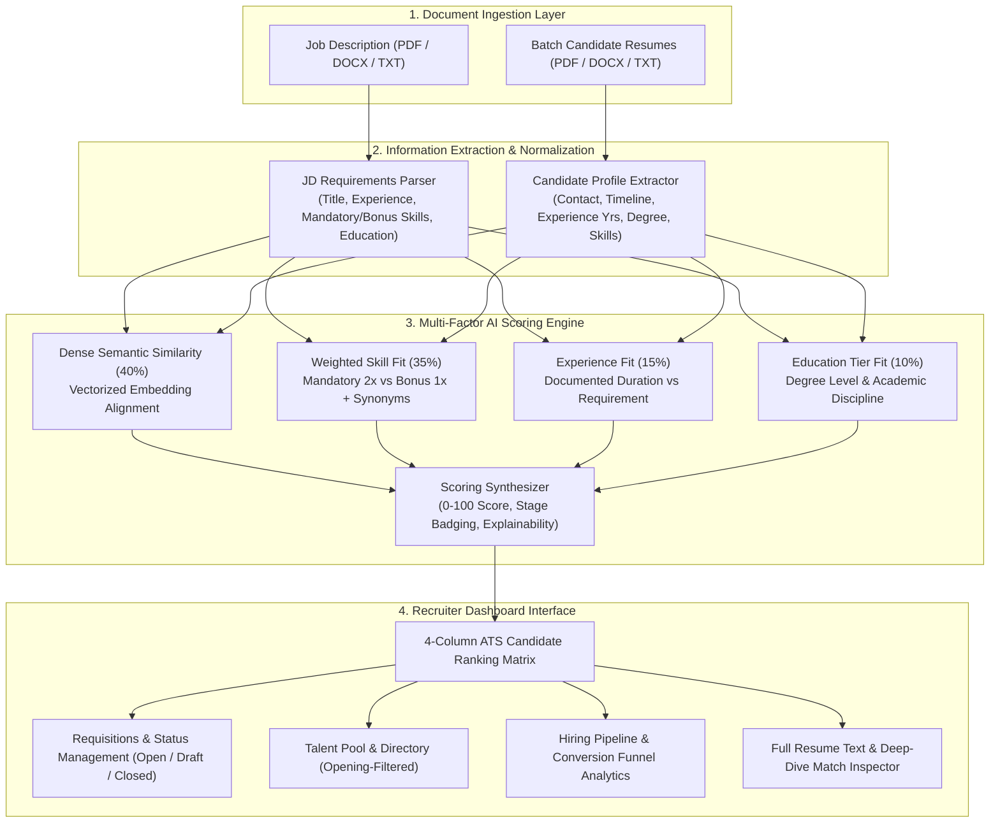

# AI-Powered Resume Matching & Candidate Ranking ATS

An enterprise-grade, recruiter-facing Applicant Tracking System (ATS) designed to automate resume screening, candidate ranking, and job description alignment using dense semantic representations and multi-factor natural language processing.

Built as a full-stack solution featuring **FastAPI**, **React.js (Vite)**, **Sentence Transformers**, and **Modern OLED Pitch-Black UI Architecture**.

---

## Table of Contents
- [System Architecture](#system-architecture)
- [Core ATS Capabilities](#core-ats-capabilities)
- [Multi-Factor AI Matching Methodology](#multi-factor-ai-matching-methodology)
- [Technology Stack](#technology-stack)
- [Clean Project Structure](#clean-project-structure)
- [Quick Start Guide](#quick-start-guide)
- [Benchmark Test Suite & Dataset](#benchmark-test-suite--dataset)
- [Evaluation Criteria Mapping](#evaluation-criteria-mapping)

---

## System Architecture



---

## Core ATS Capabilities

### 1. Job Requisition & Specification Ingestion
- **Dual Ingestion**: Parse text directly or upload multi-format `.pdf`, `.docx`, or `.txt` specifications.
- **Requirement Segmentation**: Automatically segments job title, experience thresholds, mandatory core requirements, and bonus competencies.
- **Requisition Lifecycle Management**: Easily transition job statuses across **Open**, **Draft**, and **Closed** states with real-time pipeline status tracking.

### 2. High-Capacity Batch Resume Processing
- **Universal Multi-Format Support**: High-performance extraction engine for `.pdf`, `.docx`, and `.txt` candidate files.
- **Original Document Preservation**: Stores and serves CVs in their original uploaded binary format with 1-click downloads.
- **Information Normalization**: Extracts candidate identity, contact channels, full-length career timelines, degree tiers, and normalized technical skill aliases (e.g. `K8s` -> `Kubernetes`, `React.js` -> `React`).

### 3. Explainable Multi-Factor Ranking
- **Hybrid AI Scoring**: Balances deep dense context matching with strict mandatory skill requirements, preventing keyword stuffing while rewarding practical experience.
- **Dynamic Weight Configuration**: Tailor scoring weights (Semantic, Skills, Experience, Education) in real time to match specific technical role demands.
- **Transparent Justification**: Deterministic breakdown cards with matched skills, missing mandatory requirements, and experience deltas.

### 4. Recruiter Management & Decision Pipeline
- **Candidate Advancement**: Directly manage applicant stages (`Screen` -> `Technical Interview` -> `Final Offer` / `Reject`).
- **Targeted Interview Preparation**: Automatically prepares tailored interview probing questions based on candidate skill gaps.
- **Opening-Specific Analytics**: Dynamic funnel metrics, average match scores, and skill distributions calibrated per job requisition.

---

## Multi-Factor AI Matching Methodology

The composite ATS match score $S_{	ext{total}} \in [0, 100]$ is computed using a calibrated multi-tier scoring model:

$$S_{	ext{total}} = (0.40 	imes S_{	ext{semantic}}) + (0.35 	imes S_{	ext{skills}}) + (0.15 	imes S_{	ext{experience}}) + (0.10 	imes S_{	ext{education}})$$

### 1. Semantic AI Context Fit ($S_{	ext{semantic}}$ - 40% Weight)
- Evaluates holistic contextual alignment, domain relevancy, and engineering depth beyond keyword matching.
- Vectorized sentence embeddings capture semantic synonymy and role responsibilities using cosine similarity:
  $$	ext{sim}_{\cos}(u, v) = rac{u \cdot v}{\|u\|_2 \|v\|_2}$$
- Normalized across typical embedding bounds $[0.25, 0.85] 
ightarrow [20.0, 98.0]$ for recruiter interpretability.

### 2. Weighted Skill Coverage ($S_{	ext{skills}}$ - 35% Weight)
- Differentiates non-negotiable core requirements from supplementary bonuses:
  $$S_{	ext{skills}} = rac{2 	imes |M_{	ext{matched}}| + 1 	imes |B_{	ext{matched}}|}{2 	imes |M_{	ext{total}}| + 1 	imes |B_{	ext{total}}|} 	imes 100$$
  where $M$ denotes Mandatory Core Skills and $B$ denotes Preferred Bonus Skills.

### 3. Career Experience Fit ($S_{	ext{experience}}$ - 15% Weight)
- Extracts multi-interval work tenures and compares documented industry experience against requisition minimums:
  - If $	ext{Experience}_{	ext{candidate}} \ge 	ext{Experience}_{	ext{required}}$: **100%** (surplus tenure identified)
  - If $	ext{Experience}_{	ext{candidate}} < 	ext{Experience}_{	ext{required}}$:
    $$S_{	ext{experience}} = \max\left(25.0, rac{	ext{Years}_{	ext{candidate}}}{	ext{Years}_{	ext{required}}} 	imes 100
ight)$$

### 4. Education & Academic Discipline ($S_{	ext{education}}$ - 10% Weight)
- Evaluates candidate highest degree and relevant major alignment:
  - Meets or exceeds required degree (Master's / Bachelor's in CS/STEM): **100%**
  - Adjacent technical tier: **75%**
  - Unspecified / Non-technical: **50%**

### Decision Status Badges
- **Ready for Offer** ($\ge 80\%$): Exceptional candidate alignment across mandatory requirements, semantic context, and experience duration.
- **Interview Qualified** ($60\% - 79\%$): Solid foundational candidate with targeted skill gaps suitable for technical screening.
- **Under Review / Disqualified** ($< 60\%$): Notable missing requirements or experience below threshold.

---

## Technology Stack

| Layer | Technologies |
| :--- | :--- |
| **Frontend** | React 19, Vite 8, Lucide Icons, Axios, Modern Dark Design System |
| **Backend** | Python 3.9+, FastAPI, Uvicorn, Pydantic |
| **AI / NLP** | Sentence Transformers, PyTorch, Scikit-learn, NLTK, spaCy taxonomy |
| **File Processing** | PyPDF2 (PDF parsing), python-docx (DOCX parsing), fpdf2 (PDF generation) |
| **Data Export** | RFC 4180 Native CSV Exporter |

---

## Clean Project Structure

```
Resume Matcher Project/
├── backend/
│   ├── main.py                  # FastAPI server application & API routing
│   ├── candidate_extractor.py   # Information extraction (contact, experience, degree, skills)
│   ├── jd_parser.py             # Job Description requirements & skill categorization
│   ├── batch_scorer.py          # Multi-factor hybrid AI scoring & ranking engine
│   ├── file_parser.py           # Robust multi-format byte parser (PDF, DOCX, TXT)
│   ├── nlp_engine.py            # Tokenization, keyword extraction, and ATS scoring utilities
│   ├── semantic_matcher.py      # Dense semantic embedding and cosine similarity engine
│   ├── requirements.txt         # Python backend dependencies
│   └── test_resumes/            # Synthetic benchmark dataset generator
├── frontend/
│   ├── src/
│   │   ├── components/
│   │   │   ├── Navbar.jsx       # Recruiter ATS sidebar navigation
│   │   │   └── SettingsModal.jsx # Dynamic ATS scoring weights & recruiter guardrails
│   │   ├── pages/
│   │   │   └── BatchAtsPage.jsx # Full-featured 4-column ATS ranking & analytics matrix
│   │   ├── App.jsx              # Application root shell & theme provider
│   │   ├── index.css            # OLED dark & light design system tokens
│   │   └── main.jsx             # React DOM entry point
│   └── package.json             # React dependencies & Vite build configuration
├── test_resumes/                # Benchmark multi-format test resumes (PDF, DOCX, TXT)
│   ├── sample_resumes/          # Technical candidate profiles across engineering disciplines
│   └── SAMPLE_JOB_DESCRIPTION.txt # Reference job description specification
├── run_fullstack.bat            # 1-click launch script for Windows Command Prompt
├── run_fullstack.ps1            # 1-click launch script for PowerShell
└── README.md                    # Project documentation & technical specifications
```

---

## Quick Start Guide

### Prerequisites
- Python 3.9+ with `pip`
- Node.js 18+ with `npm`

### 1-Click Launch (Windows)
Run either launcher script from the project root:
```powershell
# In PowerShell:
.\run_fullstack.ps1

# Or in Windows CMD:
run_fullstack.bat
```

### Manual Service Startup

#### 1. Start FastAPI Backend
```bash
cd backend
pip install -r requirements.txt
python -m uvicorn main:app --reload --port 8000
```
- API Documentation (Swagger UI): **http://localhost:8000/docs**

#### 2. Start React Frontend
```bash
cd frontend
npm install
npm run dev
```
- Recruiter ATS Portal: **http://localhost:5173**

---

## Benchmark Test Suite & Dataset

The repository includes a comprehensive, multi-format evaluation suite in `test_resumes/` designed to benchmark the ATS matching engine against diverse hiring criteria:

- **Technical Domains Covered**: Full Stack & AI Engineering, Backend Development, Infrastructure / Cloud DevOps, Data Science, and QA Automation.
- **Experience Spectrum**: Calibrated across multiple career phases, spanning fresh graduates (0 years) through senior engineering leads (5+ years).
- **Document Format Testing**: Multi-format test corpus provided in native `.pdf`, `.docx`, and `.txt` files to validate parser resilience.
- **Scoring Distribution**: Formulated to produce a realistic distribution of candidates across Offer Ready ($\ge 80\%$), Interview Qualified ($60\% - 79\%$), and Disqualified ($< 60\%$) tiers.

> **1-Click Live Evaluation**: Click **"Load Demo Dataset"** in the top action bar to instantly populate candidate profiles and execute batch AI evaluation in under 2 seconds.

---

